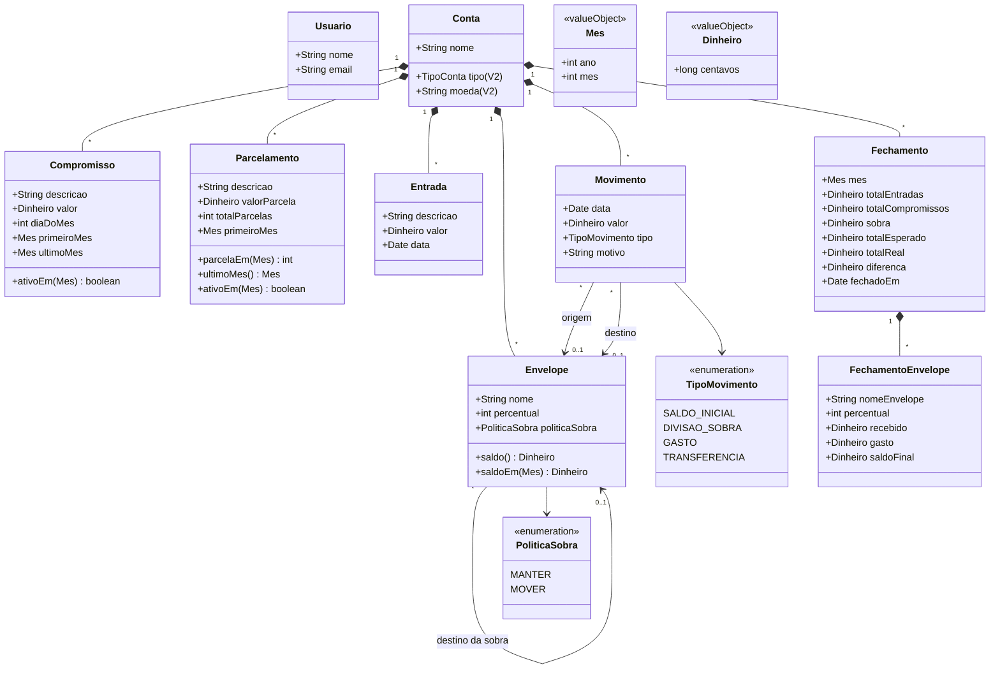
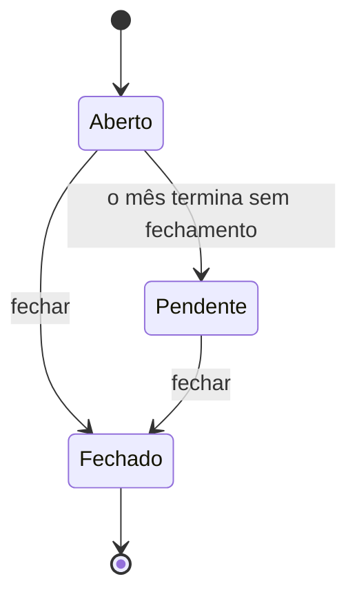
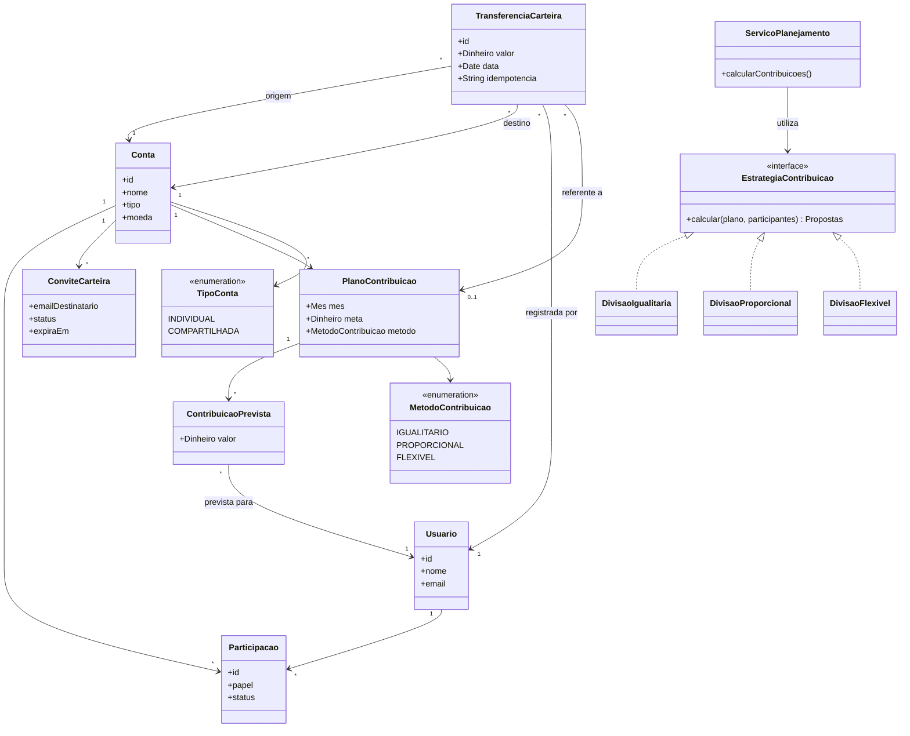
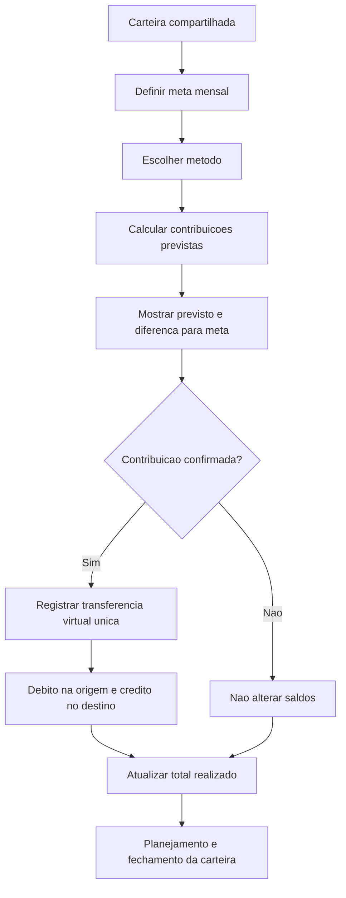

# Organizador Financeiro: Modelagem

**Versão:** 0.2 (rascunho para revisão)  
**Baseado em:** `visao.md` (v0.5) e `requisitos.md` (v0.3)  
**Atualização:** 23/11/2026 — modelo evolutivo de carteiras e estratégias de contribuição

---

## 1. Decisões de modelagem

1. **Dinheiro é guardado em centavos** (número inteiro), para atender ao RNF03 (exatidão ao centavo).
2. **Não existe classe "Mês" como entidade persistida.** `Mes` é objeto de valor; um mês está fechado se existe um `Fechamento` para ele. Aberto e pendente são situações *calculadas*, não gravadas.
3. **Compromissos e parcelamentos nunca são editados nem apagados retroativamente, só encerrados.** Para mudar o valor do aluguel, encerra-se o compromisso atual e cria-se outro a partir do mês da mudança. Isso preserva o histórico (RF02, RN11).
4. **O saldo de um envelope não é guardado.** É a soma dos seus movimentos.
5. **Um gasto de envelope é um movimento**, e não um campo à parte. Assim todo valor que entra ou sai de um envelope passa pelo mesmo registro.
6. **O fechamento guarda uma foto** (nome, percentual e valores de cada envelope naquele mês), para que o histórico não mude se o envelope for renomeado ou alterado depois (RN02).
7. **Usuário e Conta são separados** desde já, para que o convite por e-mail da V2 caiba sem refazer o modelo.
8. **`Conta` representa uma carteira de planejamento, não uma conta bancária.** V1 usa uma `Conta` local. V2 introduz os tipos `INDIVIDUAL` e `COMPARTILHADA`, associados a usuários por `Participacao`.
9. **`Movimento` e `TransferenciaCarteira` são coisas diferentes.** O primeiro movimenta valores *dentro dos envelopes de uma mesma conta*; a segunda registra um aporte virtual *entre duas contas/carteiras*.
10. **Plano não é lançamento.** Um `PlanoContribuicao` e suas `ContribuicaoPrevista` não produzem débitos/créditos. Somente uma `TransferenciaCarteira` confirmada produz os dois efeitos vinculados (RN20).
11. **Estratégias independentes.** O método selecionado fica no plano do mês; um serviço de aplicação seleciona a implementação de `EstrategiaContribuicao` (padrão Strategy). Não há necessidade de três subtipos de `Conta`.
12. **V1 permanece no escopo atual.** As classes da V2 descritas adiante são planejamento de arquitetura, não pré-requisitos para entregar o MVP.

## 2. Diagrama de classes — núcleo atual (V1)

`Usuario` aparece aqui apenas como entidade prevista para V2; na V1 não é preciso implementar login. O relacionamento de usuários com contas está detalhado no diagrama seguinte, por meio de `Participacao` (em vez da antiga associação direta "1..2 usuários por conta").

## 3. O que cada classe do núcleo faz

| Classe | Responsabilidade | Requisitos |
|---|---|---|
| `Conta` | Agrupa compromissos, entradas, envelopes e fechamentos. Na V1 existe uma só, local. Na V2 representa uma carteira individual ou compartilhada. | RNF05; RF28, RF29 (V2) |
| `Usuario` | Pessoa com e-mail e login. Só entra na V2. | RF23, RF28 |
| `Compromisso` | Gasto recorrente conhecido de antemão. Sabe se está ativo em um mês. | RF01, RF02, RF05 |
| `Parcelamento` | Dívida com número fixo de parcelas. Calcula a parcela atual e o último mês. | RF03, RF04, RN06 |
| `Entrada` | Dinheiro recebido externamente, com valor diferente a cada mês. Na V2 uma transferência virtual não vira outra `Entrada` externa. | RF06, RN24 |
| `Envelope` | Parte da sobra reservada para um fim. Tem percentual, política de sobra e, se for o caso, o envelope para onde a sobra vai. Pertence a exatamente uma `Conta`. | RF09 a RF12 |
| `Movimento` | Entrada ou saída de valor em envelope, **dentro da mesma `Conta`**. É a base do saldo do envelope. | RF13, RF14 |
| `Fechamento` | Foto permanente de um mês fechado, por `Conta`. | RF20, RF21 |
| `FechamentoEnvelope` | Foto de cada envelope dentro de um fechamento. | RF20 |

## 4. O que é calculado e não gravado

| Valor | Como se calcula |
|---|---|
| Parcela atual | Diferença em meses entre o mês consultado e o `primeiroMes`, mais 1 |
| Último mês de um parcelamento | `primeiroMes` mais `totalParcelas` menos 1 |
| Compromissos do mês | Soma dos compromissos e parcelas ativos naquele mês |
| Sobra do mês (V1) | Entradas externas do mês menos compromissos do mês (RN05) |
| Saldo de um envelope | Soma dos movimentos que entram menos os que saem |
| Mês aberto ou pendente | Aberto se não há fechamento e o mês não terminou; pendente se não há fechamento e o mês já terminou |
| Total previsto de contribuições (V2) | Soma das propostas registradas para cada participante no plano do mês |
| Total realizado de contribuições (V2) | Soma das transferências virtuais confirmadas relacionadas ao plano do mês |
| Valor faltante (V2) | `max(0, meta - total realizado)`; não confundir com o que falta *planejar* |

## 5. Diagrama de estados do mês

- Só é possível fechar se o mês anterior já estiver fechado (RN01).
- **Fechado é um estado final.** Não há volta (RN02).
- Aberto e Pendente não são gravados: derivam da data e da existência do fechamento.
- Na V2, a condição de fechado é **por `Conta` e `Mes`**, não global a todas as carteiras de um usuário.

## 6. Tipos de movimento em envelopes (V1)

| Tipo | Origem | Destino | Efeito na soma dos envelopes |
|---|---|---|---|
| `SALDO_INICIAL` | nenhuma | envelope | aumenta |
| `DIVISAO_SOBRA` | nenhuma (sobra do mês) | envelope | aumenta |
| `GASTO` | envelope | nenhuma | diminui |
| `TRANSFERENCIA` | envelope | envelope | não muda (RN04) |

A cobertura de um estouro (RF17) e a movimentação de sobra (RF18) são `TRANSFERENCIA`, diferenciadas pelo campo `motivo`.

**Invariante de verificação:** dentro de cada `Conta`, a soma dos saldos de todos os envelopes é sempre igual à soma dos `SALDO_INICIAL` e `DIVISAO_SOBRA`, menos a soma dos `GASTO`. Se isso falhar, há um bug.

**Atenção:** `TRANSFERENCIA` nesta tabela ocorre **entre envelopes da mesma carteira**. Um aporte da carteira individual para a compartilhada é uma `TransferenciaCarteira` diferente e não deve ser contabilizado automaticamente como `DIVISAO_SOBRA` e `Entrada` externa ao mesmo tempo.

## 7. Fluxo do fechamento (V1, preservado)

Ordem em que o sistema conduz o fechamento do mês M:

1. Verifica se o mês anterior está fechado (RN01).
2. O usuário informa o total gasto de cada envelope. Gera movimentos `GASTO` (RF15).
3. O sistema avisa quais envelopes estouraram (gasto maior que o saldo do início do mês, RN13) e quais sobraram (RF16).
4. Para cada estouro, o usuário escolhe qual envelope cobre. Gera `TRANSFERENCIA` (RF17).
5. O sistema propõe as movimentações de sobra conforme a política de cada envelope. O usuário confirma. Gera `TRANSFERENCIA` (RF18, RN08).
6. O sistema calcula a sobra do mês (RN05). Se for negativa, não divide e informa o déficit (RN09). Se for positiva, divide entre os envelopes. Gera `DIVISAO_SOBRA` (RF11, RN14).
7. O usuário pode ajustar os percentuais para o mês seguinte (RF22).
8. O usuário informa o total real que tem guardado, e o sistema mostra a diferença (RF19).
9. O usuário confirma e o sistema grava o `Fechamento` com os `FechamentoEnvelope` (RF20).

Consequência: o dinheiro de um mês é gasto a partir do que foi dividido nos fechamentos anteriores. Por isso o primeiro mês precisa de saldo inicial (RF27).

## 8. Diagrama de classes — colaboração e contribuições (V2)

**Observações sobre as associações:**

- `Participacao` substitui a antiga relação direta `Usuario ↔ Conta` e permite que um usuário participe de sua conta individual e de uma compartilhada. A V2 começa com **até dois participantes ativos na compartilhada**.
- Cada conta individual tem exatamente um proprietário na V2. A participação na conta compartilhada não autoriza acesso à individual de outra pessoa.
- `ConviteCarteira` é pedido de acesso pendente; só após aceite uma `Participacao` ativa concede acesso.
- `PlanoContribuicao` é **por `Conta` compartilhada e por `Mes`**, com uma meta e um método escolhidos. O plano guarda a configuração histórica, e `ContribuicaoPrevista` guarda os resultados destinados a cada participante.
- O serviço escolhe uma implementação de `EstrategiaContribuicao` com base no `metodo` do plano. **Não** persistimos subclasses de conta para cada método.
- `TransferenciaCarteira` representa **um único evento** entre duas carteiras. Seus efeitos de -valor e +valor devem ocorrer juntos, em operação atômica e idempotente (RNF09). Não é uma transferência bancária.
- Um `Fechamento` de V2 precisará registrar uma fotografia dos valores previstos e realizados do mês, evitando que cálculos futuros reescrevam o passado. Detalhe do snapshot ainda será definido.

## 9. Regras matemáticas das estratégias (V2)

### 9.1 Igualitário

Para uma meta `T` em centavos e `n` participantes ativos: cada um recebe `T // n` centavos; os `T % n` centavos restantes são distribuídos, um por participante, em **ordem estável de identificador**. A soma será sempre `T` (RN16).

### 9.2 Proporcional à renda

Cada participante informa uma **renda de referência** privada, na mesma moeda da meta. O peso de cada um é `renda_i / soma_rendas`. O serviço calcula quotas exatas em centavos e distribui os centavos residuais pelo método de **maiores restos**, com desempate por identificador estável. Se todas as rendas forem zero, o cálculo não prossegue (RN17). A aplicação informa previamente o risco de inferência de renda (RN21, RF42).

**Exemplo:** meta 1.400 €; rendas de 2.000 € e 1.600 € → contribuições propostas de **777,78 € e 622,22 €**.

### 9.3 Flexível

Cada participante escolhe um valor não negativo. Os valores são somados e comparados à meta:

- igual à meta → planejamento atendido;
- menor que a meta → falta explicitamente informada;
- maior que a meta → excesso informado, sem aplicação automática.

O fato de o plano estar completo não significa que a transferência foi feita (RN18, RN20).

## 10. Fluxo de contribuição entre carteiras (V2)

**Invariantes da V2:**

1. A soma dos valores *previstos* não altera o dinheiro *realizado*.
2. Para cada `TransferenciaCarteira`, a variação agregada entre as duas contas é zero na mesma moeda (`-valor + valor = 0`).
3. A mesma chave de idempotência não pode criar duas contribuições efetivas.
4. Transferência interna não é `Entrada` externa na consolidação das finanças do casal.
5. Um participante não acessa dados de uma conta sem `Participacao` ativa ou propriedade, conforme sua permissão.
6. Alterar método, renda de referência ou meta de mês futuro não modifica um mês já fechado.

## 11. Limites e pontos para detalhar na próxima etapa

- **Conciliação da V1:** definir exatamente o que compõe o "total esperado" e o "total real" (só os envelopes ou também dinheiro reservado para compromissos).
- **Detalhe de um mês fechado:** decidir se o fechamento guarda a lista de compromissos e entradas ou se ela é reconstruída (a decisão 3 da seção 1 torna a reconstrução possível).
- **Ledger da V2:** especificar cálculo do saldo agregado por `Conta` sem confundir dinheiro disponível com envelope/reserva e sem subtrair gasto variável duas vezes.
- **Migração V1 → V2:** a conta local já usada por um casal não deve ser transformada automaticamente em carteira individual de uma das pessoas.
- **Correção de contribuições e meses fechados:** definir estorno ou lançamento compensatório sem editar o histórico imutável.
- **Moedas:** V2 inicialmente impede contribuição entre carteiras de moedas diferentes; conversão requer uma decisão explícita posterior.
- **Permissões e desligamento:** especificar quem pode convidar, editar ou sair, como preservar histórico e o que fazer com contribuições já efetuadas.
- **Testes:** casos de borda de centavos, renda zero, contribuição incompleta, envio duplicado, concorrência de dois dispositivos e acesso indevido a dados privados.

**Próxima atividade recomendada:** primeiro implementar e testar o núcleo V1. Depois, prototipar isoladamente o cálculo das três estratégias antes de integrar autenticação e carteiras compartilhadas.
