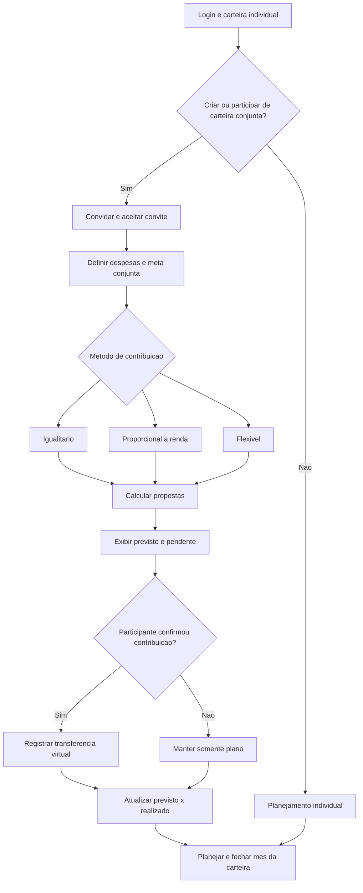

# Organizador Financeiro: Requisitos

**Versão:** 0.3 (rascunho para revisão)  
**Baseado em:** `visao.md` (v0.5)  
**Atualização:** 23/11/2026 — evolução para carteiras e contribuições (V2)

---

## Como ler este documento

- **RF** (requisito funcional): o que o sistema faz.
- **RNF** (requisito não funcional): como ele deve ser, sob quais condições.
- **RN** (regra de negócio): regra do domínio, que valeria mesmo numa planilha ou num caderno.
- **Prioridade** (método MoSCoW): **Must** = obrigatório; **Should** = importante, mas o produto funciona sem; **Could** = desejável.
- **Versão:** V1 = MVP local; V2 = evolução multiusuário após o MVP.
- Itens marcados com **(proposta)** são sugestões a validar. As decisões sobre os **três métodos** e a **privacidade de carteiras individuais** já foram aprovadas.

---

## 1. Requisitos funcionais

### Compromissos e parcelamentos

| ID | Requisito | Prioridade | Versão |
|---|---|---|---|
| RF01 | O sistema deve permitir cadastrar um compromisso recorrente com descrição, valor e dia do mês. | Must | V1 |
| RF02 | O sistema deve permitir alterar ou encerrar um compromisso recorrente a partir de um mês, sem modificar meses já fechados. | Must | V1 |
| RF03 | O sistema deve permitir cadastrar um parcelamento com descrição, valor da parcela, número total de parcelas e mês da primeira parcela. | Must | V1 |
| RF04 | O sistema deve calcular e exibir, para qualquer mês, a parcela atual e o mês da última parcela de cada parcelamento. | Must | V1 |
| RF05 | O sistema deve incluir automaticamente, ao abrir um mês, os compromissos recorrentes e as parcelas devidas naquele mês. | Must | V1 |

### Entradas e resumo do mês

| ID | Requisito | Prioridade | Versão |
|---|---|---|---|
| RF06 | O sistema deve permitir registrar entradas em um mês, com descrição, valor e data, aceitando valores diferentes a cada mês. | Must | V1 |
| RF07 | O sistema deve calcular e exibir a sobra do mês, atualizada a cada alteração enquanto o mês estiver aberto. | Must | V1 |
| RF08 | O sistema deve exibir um resumo do mês com entradas, compromissos, sobra e situação de cada envelope. | Must | V1 |

### Envelopes

| ID | Requisito | Prioridade | Versão |
|---|---|---|---|
| RF09 | O sistema deve permitir criar, renomear e apagar envelopes. | Must | V1 |
| RF10 | O sistema deve permitir definir o percentual da sobra destinado a cada envelope. | Must | V1 |
| RF11 | O sistema deve dividir a sobra do mês entre os envelopes conforme os percentuais definidos. | Must | V1 |
| RF12 | O sistema deve permitir definir, para cada envelope, o destino da sobra no fechamento: manter no envelope ou mover para outro envelope. | Must | V1 |
| RF13 | O sistema deve permitir mover valor entre envelopes, registrando origem, destino, valor, data e motivo opcional. | Must | V1 |
| RF14 | O sistema deve calcular o saldo de cada envelope a partir dos seus movimentos. | Must | V1 |
| RF27 | O sistema deve permitir informar, ao começar a usar o aplicativo, o mês de início e o saldo inicial de cada envelope. | Must | V1 |

### Fechamento do mês

| ID | Requisito | Prioridade | Versão |
|---|---|---|---|
| RF15 | O sistema deve permitir informar, no fechamento, o total gasto de cada envelope. | Must | V1 |
| RF16 | O sistema deve avisar, no fechamento, quando um envelope estourou o limite e quando sobrou valor. | Must | V1 |
| RF17 | O sistema deve, quando um envelope estourou, perguntar de qual outro envelope sai o valor de cobertura e registrar esse movimento. | Must | V1 |
| RF18 | O sistema deve propor, no fechamento, as movimentações de sobra conforme a política de cada envelope e aplicá-las somente após confirmação do usuário. | Must | V1 |
| RF19 | O sistema deve permitir informar o total real que o usuário tem guardado, compará-lo com o total esperado e exibir a diferença. | Must | V1 |
| RF20 | O sistema deve fechar o mês após confirmação, gravando um registro permanente com entradas, compromissos, sobra, gasto e saldo de cada envelope e a diferença da conciliação. | Must | V1 |
| RF21 | O sistema deve listar os meses fechados e permitir consultar o fechamento de cada um. | Must | V1 |
| RF22 | O sistema deve permitir ajustar os percentuais dos envelopes para o mês seguinte durante o fechamento. | Should | V1 |

### Evoluções já previstas

| ID | Requisito | Prioridade | Versão |
|---|---|---|---|
| RF23 | O sistema deve permitir que um usuário convide outra pessoa, por e-mail, para participar da mesma carteira compartilhada. | Should | V2 |
| RF24 | O sistema deve permitir lançar cada gasto durante o mês, escolhendo o envelope. | Should | V2 |
| RF25 | O sistema deve exibir uma retrospectiva com padrões entre meses (por exemplo, envelope que estourou vários meses seguidos). | Should | V2 |
| RF26 | O sistema deve permitir definir metas com valor, prazo e contribuição mensal recomendada. | Could | V2 |

### Carteiras individuais e compartilhadas (novos requisitos)

| ID | Requisito | Prioridade | Versão |
|---|---|---|---|
| RF28 | Após o cadastro, o sistema deve associar ao usuário uma carteira individual privada. | Must | V2 |
| RF29 | O sistema deve permitir criar uma carteira compartilhada independente das individuais, com seus próprios compromissos, envelopes, metas e fechamentos. | Must | V2 |
| RF30 | O usuário convidado deve poder aceitar ou recusar o convite; o acesso só é concedido após aceite. | Must | V2 |
| RF31 | Os participantes devem poder escolher o método de contribuição mensal: igualitário, proporcional à renda de referência ou flexível. | Must | V2 |
| RF32 | No método igualitário, o sistema deve propor parcelas iguais da meta mensal, ajustando centavos residuais de modo determinístico. | Must | V2 |
| RF33 | No método proporcional, o sistema deve calcular valores de acordo com rendas de referência não negativas fornecidas privadamente, sem exibir rendas absolutas ao outro participante. | Must | V2 |
| RF34 | No método flexível, o sistema deve permitir informar um valor de contribuição para cada participante. | Must | V2 |
| RF35 | O sistema deve permitir que metas e envelopes pertençam à carteira individual ou à compartilhada. | Should | V2 |
| RF36 | O sistema deve permitir registrar uma contribuição efetiva como transferência virtual única com origem, destino, valor, data e participante responsável, afetando os dois lados de modo consistente. | Must | V2 |
| RF37 | O sistema deve mostrar, separadamente, os totais previstos, os realizados e o que ainda falta para cumprir a meta mensal da carteira compartilhada. | Must | V2 |
| RF38 | Os participantes devem poder alterar o método para planejamentos futuros sem modificar valores ou fechamentos históricos. | Must | V2 |
| RF39 | O sistema deve informar quando as contribuições flexíveis propostas não alcançam a meta mensal ou ultrapassam a meta, sem registrar automaticamente o excedente. | Must | V2 |
| RF40 | Cada carteira deve possuir uma moeda de referência selecionável entre EUR, BRL e USD; operações entre carteiras de moedas distintas ficam bloqueadas até existir regra de conversão explícita. | Should | V2 |
| RF41 | Dados da carteira individual de outra pessoa não devem estar visíveis a participantes da carteira compartilhada, salvo autorização específica futura. | Must | V2 |
| RF42 | Antes de ativar o método proporcional, o sistema deve avisar que contribuições/proporções exibidas podem permitir inferir informações sobre a renda do outro. | Must | V2 |
| RF43 | O sistema deve manter histórico consultável de contribuições efetuadas, sem alterar meses fechados. | Must | V2 |

---

## 2. Regras de negócio

### Regras originais do MVP (RN01–RN14)

| ID | Regra |
|---|---|
| RN01 | Um mês só pode ser fechado depois de todos os meses anteriores estarem fechados. |
| RN02 | Um mês fechado não pode ser alterado. |
| RN03 | Um envelope não pode ficar com saldo negativo sem que se indique de qual outro envelope sai a cobertura. |
| RN04 | Mover valor entre envelopes não altera a soma total dos saldos dos envelopes. |
| RN05 | Na V1, a sobra do mês é igual ao total de entradas menos o total de compromissos do mês. Gastos variáveis dos envelopes são tratados no fechamento, sem serem subtraídos duas vezes. |
| RN06 | A parcela atual de um parcelamento é calculada a partir do mês da primeira parcela; depois da última parcela, o parcelamento deixa de aparecer nos meses seguintes. |
| RN07 | Os percentuais de divisão da sobra entre os envelopes devem somar 100%. **(proposta)** |
| RN08 | A movimentação de sobra no fechamento é calculada sobre os saldos do fim do mês, sem encadeamento: a sobra movida do envelope A para o B não é movida de novo pela regra do B. **(proposta)** |
| RN09 | Se a sobra do mês for negativa (compromissos maiores que entradas), o sistema não a divide entre os envelopes e informa o valor do déficit. **(proposta)** |
| RN10 | Um envelope só pode ser apagado se o saldo for zero. **(proposta)** |
| RN11 | Alterar ou encerrar um compromisso, parcelamento ou envelope não modifica o histórico dos meses já fechados. |
| RN12 | Na V2, os participantes de uma carteira compartilhada acessam seus compromissos, envelopes e contribuições, mas não as carteiras individuais alheias. Esta regra substitui a hipótese anterior de expor todos os envelopes pessoais. |
| RN13 | Um envelope estoura no fechamento quando o gasto informado do mês é maior que o seu saldo no início desse mês. **(proposta)** |
| RN14 | A sobra do mês é dividida entre os envelopes no fechamento e fica disponível a partir do mês seguinte. **(proposta)** |

### Novas regras das carteiras compartilhadas (RN15–RN25)

| ID | Regra |
|---|---|
| RN15 | Cada carteira compartilhada possui, para cada mês planejado, uma meta de contribuição e um método: igualitário, proporcional ou flexível. |
| RN16 | A divisão igualitária reparte a meta pelo número de participantes ativos; centavos indivisíveis são distribuídos em ordem estável por identificador, totalizando exatamente a meta. |
| RN17 | A divisão proporcional usa rendas de referência não negativas na mesma moeda da meta. Se a soma das rendas for zero, não há cálculo proporcional e o sistema solicita outro método ou novas rendas. |
| RN18 | A divisão flexível aceita valores não negativos por participante; se a soma diferir da meta, exibe claramente falta ou excesso. A divergência não cria contribuição automaticamente. |
| RN19 | A mudança de método/renda de referência afeta apenas propostas ainda abertas e meses futuros. Contribuições realizadas e fechamentos históricos são preservados. |
| RN20 | Contribuição prevista é planejamento; somente a contribuição confirmada gera uma transferência virtual registrada com débito na origem e crédito no destino. |
| RN21 | A renda individual é privada. O compartilhamento de proporções e contribuições calculadas pode revelar inferências sobre a renda e exige aviso prévio. |
| RN22 | A soma das contribuições propostas deve ser comparada à meta mensal; a aplicação distingue meta atingida, insuficiência e excedente. |
| RN23 | Cada transferência virtual tem identificador único, carteira de origem, carteira de destino, quantia, moeda, data e usuário responsável, de modo que possa ser auditada e não duplicada. |
| RN24 | Uma transferência entre carteiras é movimentação interna, não renda externa nova do casal; não deve aparecer duas vezes em totais consolidados. |
| RN25 | Todos os cálculos monetários são feitos em unidades inteiras mínimas da moeda (centavos para EUR, BRL e USD), com regra estável de arredondamento. |

### Exemplos verificáveis de aceitação (V2)

| Cenário | Resultado esperado |
|---|---|
| Meta 1.400 €, dois participantes, método igualitário | 700,00 € para cada, soma exata de 1.400,00 €. |
| Meta 1.400 €, rendas 2.000 € e 1.600 €, método proporcional | 777,78 € e 622,22 € (arredondamento controlado), soma exata. |
| Meta 1.400 €, método flexível com 800 € e 600 € | Proposta válida, total 1.400 €. |
| Meta 1.400 €, método flexível com 500 € e 600 € | Falta de 300 € exibida; nenhum débito automático. |
| Rendas de referência 0 € e 0 €, método proporcional | Cálculo recusado com mensagem clara. |
| Contribuição prevista de 600 €, sem confirmação | Saldos não se alteram. |
| Transferência virtual confirmada de 600 €, mesma moeda | Uma operação identificada, -600 € na origem e +600 € no destino; total consolidado inalterado. |
| Usuário A entra na carteira compartilhada | Não consegue consultar rendas nem envelopes da carteira individual de B. |
| Alteração do método após fechamento de um mês | Histórico fechado permanece igual. |

---

## 3. Requisitos não funcionais

| ID | Categoria | Requisito | Prioridade |
|---|---|---|---|
| RNF01 | Desempenho | O resumo do mês deve abrir em até 2 segundos, com 36 meses de histórico. **(proposta)** | Should |
| RNF02 | Usabilidade | O fechamento de um mês deve poder ser concluído em até 10 minutos. **(proposta, vem do critério de sucesso da visão)** | Should |
| RNF03 | Precisão | Todos os cálculos monetários devem ser exatos ao centavo, sem erros de arredondamento. | Must |
| RNF04 | Confiabilidade | Dados já registrados não podem ser perdidos caso o aplicativo seja fechado de forma inesperada. | Must |
| RNF05 | Privacidade | Na V1, os dados financeiros ficam apenas no dispositivo do usuário e não são enviados a terceiros. | Must |
| RNF06 | Portabilidade | O sistema deve funcionar no computador do usuário. A necessidade de funcionar também no celular será definida na etapa de arquitetura. | Must |
| RNF07 | Localização | Na V1, a interface deve estar em português e os valores devem ser exibidos em euro (€). | Must |
| RNF08 | Autorização (V2) | Todas as leituras/escritas devem validar no servidor a participação do usuário na carteira e impedir acesso a dados individuais de terceiros. | Must |
| RNF09 | Integridade (V2) | Registrar contribuição efetiva deve ser transacional e idempotente, impedindo débito sem crédito ou envio duplicado. | Must |
| RNF10 | Moedas (V2) | Não realizar conversão implícita entre moedas e apresentar sempre a moeda correspondente ao valor. | Must |
| RNF11 | Testabilidade | As regras dos três métodos e seus casos de borda devem possuir testes automatizados. | Must |

---

## 4. Fluxo funcional previsto para a V2

*O diagrama da V2 não muda o fluxo do fechamento local da V1.*

## 5. Para validar posteriormente

1. As propostas antigas: RN07–RN10, RN13–RN14 e os limites quantitativos RNF01/RNF02.
2. Se alguma função atual Must da V1 pode ser adiada para reduzir o MVP.
3. RNF06: o MVP começa somente no computador ou também no celular?
4. Migração da conta local V1 para contas individuais/compartilhadas V2 sem expor históricos anteriores.
5. Políticas detalhadas para remoção de participante, permissões, correções contábeis em meses fechados e relação entre saldos das carteiras e envelopes.

**Decisões já tomadas:** três métodos de contribuição; carteiras individuais privadas e uma carteira compartilhada; planejamento separado de contribuição realizada; preservação do MVP local.
