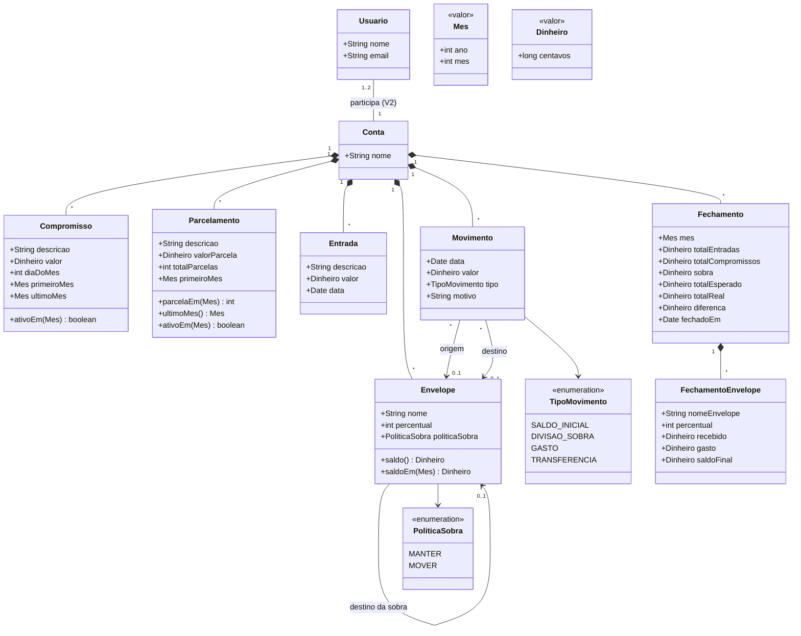
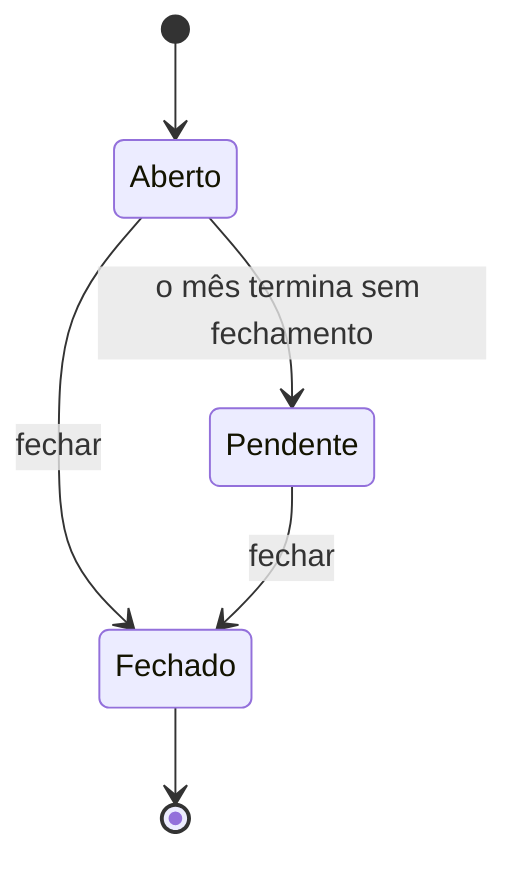

# Organizador Financeiro: Modelagem

**Versão:** 0.1 (rascunho para revisão)
**Baseado em:** `visao.md` (v0.4) e `requisitos.md` (v0.2)

---

## 1. Decisões de modelagem

1. **Dinheiro é guardado em centavos** (número inteiro), para atender ao RNF03 (exatidão ao centavo).
2. **Não existe classe "Mês".** Um mês está fechado se existe um `Fechamento` para ele. Aberto e pendente são situações *calculadas*, não gravadas.
3. **Compromissos e parcelamentos nunca são editados nem apagados, só encerrados.** Para mudar o valor do aluguel, encerra-se o compromisso atual e cria-se outro a partir do mês da mudança. Isso preserva o histórico (RF02, RN11).
4. **O saldo de um envelope não é guardado.** É a soma dos seus movimentos.
5. **Um gasto é um movimento**, e não um campo à parte. Assim todo valor que entra ou sai de um envelope passa pelo mesmo registro.
6. **O fechamento guarda uma foto** (nome, percentual e valores de cada envelope naquele mês), para que o histórico não mude se o envelope for renomeado ou alterado depois (RN02).
7. **Usuário e Conta são separados** desde já, para que o convite por e-mail da V2 caiba sem refazer o modelo.

## 2. Diagrama de classes

## 3. O que cada classe faz

| Classe | Responsabilidade | Requisitos |
|---|---|---|
| `Conta` | Reúne tudo o que pertence ao casal. Na V1 existe uma só. | RNF05 |
| `Usuario` | Pessoa com e-mail e login. Só entra na V2. | RF23 |
| `Compromisso` | Gasto recorrente conhecido de antemão. Sabe se está ativo em um mês. | RF01, RF02, RF05 |
| `Parcelamento` | Dívida com número fixo de parcelas. Calcula a parcela atual e o último mês. | RF03, RF04, RN06 |
| `Entrada` | Dinheiro recebido, com valor diferente a cada mês. | RF06 |
| `Envelope` | Parte da sobra reservada para um fim. Tem percentual, política de sobra e, se for o caso, o envelope para onde a sobra vai. | RF09 a RF12 |
| `Movimento` | Qualquer entrada ou saída de valor em um envelope. É a base do saldo. | RF13, RF14 |
| `Fechamento` | Foto permanente de um mês fechado. | RF20, RF21 |
| `FechamentoEnvelope` | Foto de cada envelope dentro de um fechamento. | RF20 |

## 4. O que é calculado e não gravado

| Valor | Como se calcula |
|---|---|
| Parcela atual | Diferença em meses entre o mês consultado e o `primeiroMes`, mais 1 |
| Último mês de um parcelamento | `primeiroMes` mais `totalParcelas` menos 1 |
| Compromissos do mês | Soma dos compromissos e parcelas ativos naquele mês |
| Sobra do mês | Entradas do mês menos compromissos do mês (RN05) |
| Saldo de um envelope | Soma dos movimentos que entram menos os que saem |
| Mês aberto ou pendente | Aberto se não há fechamento e o mês não terminou; pendente se não há fechamento e o mês já terminou |

## 5. Diagrama de estados do mês

- Só é possível fechar se o mês anterior já estiver fechado (RN01).
- **Fechado é um estado final.** Não há volta (RN02).
- Aberto e Pendente não são gravados: derivam da data e da existência do fechamento.

## 6. Tipos de movimento

| Tipo | Origem | Destino | Efeito na soma dos envelopes |
|---|---|---|---|
| `SALDO_INICIAL` | nenhuma | envelope | aumenta |
| `DIVISAO_SOBRA` | nenhuma (sobra do mês) | envelope | aumenta |
| `GASTO` | envelope | nenhuma | diminui |
| `TRANSFERENCIA` | envelope | envelope | não muda (RN04) |

A cobertura de um estouro (RF17) e a movimentação de sobra (RF18) são `TRANSFERENCIA`, diferenciadas pelo campo `motivo`.

**Invariante de verificação:** a soma dos saldos de todos os envelopes é sempre igual à soma dos `SALDO_INICIAL` e `DIVISAO_SOBRA`, menos a soma dos `GASTO`. Se isso falhar, há um bug.

## 7. Fluxo do fechamento

Ordem em que o sistema conduz o fechamento do mês M:

1. Verifica se o mês anterior está fechado (RN01).
2. O usuário informa o total gasto de cada envelope. Gera movimentos `GASTO` (RF15).
3. O sistema avisa quais envelopes estouraram (gasto maior que o saldo do início do mês, RN13) e quais sobraram (RF16).
4. Para cada estouro, o usuário escolhe qual envelope cobre. Gera `TRANSFERENCIA` (RF17).
5. O sistema propõe as movimentações de sobra conforme a política de cada envelope. O usuário confirma. Gera `TRANSFERENCIA` (RF18, RN08).
6. O sistema calcula a sobra do mês (RN05). Se for negativa, não divide e informa o déficit (RN09). Se for positiva, divide entre os envelopes. Gera `DIVISAO_SOBRA` (RF11, RN14).
7. O usuário pode ajustar os percentuais para o mês seguinte (RF22).
8. O usuário informa o total real que tem guardado, e o sistema mostra a diferença (RF19).
9. O usuário confirma e o sistema grava o `Fechamento` com os `FechamentoEnvelope` (RF20).

Consequência: o dinheiro de um mês é gasto a partir do que foi dividido nos fechamentos anteriores. Por isso o primeiro mês precisa de saldo inicial (RF27).

## 8. Pontos a detalhar mais adiante

- **Conciliação:** definir exatamente o que compõe o "total esperado" e o "total real" (só os envelopes, ou também o dinheiro reservado para os compromissos).
- **Detalhe de um mês fechado:** além dos totais, decidir se o fechamento guarda a lista de compromissos e entradas ou se ela é reconstruída (a decisão 3 da seção 1 torna a reconstrução possível).
